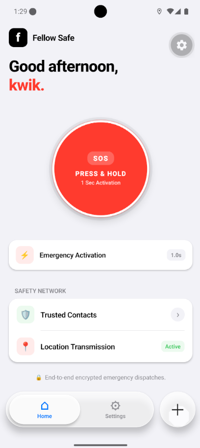
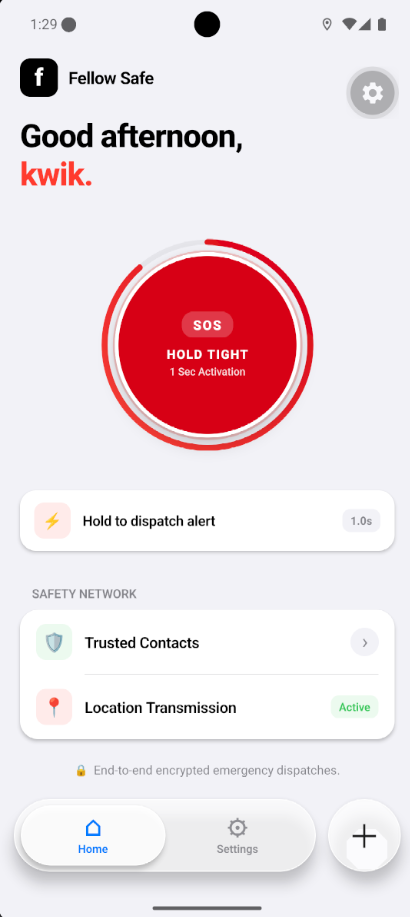
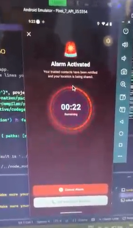
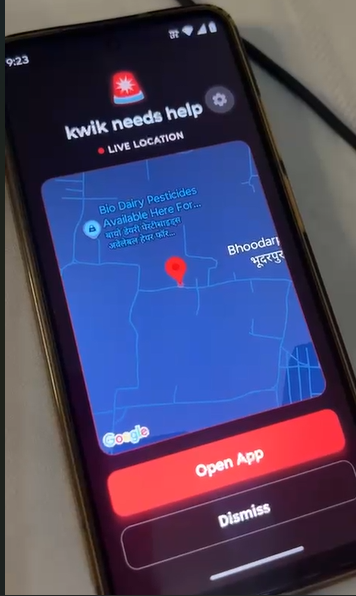
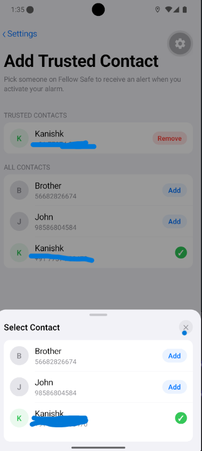
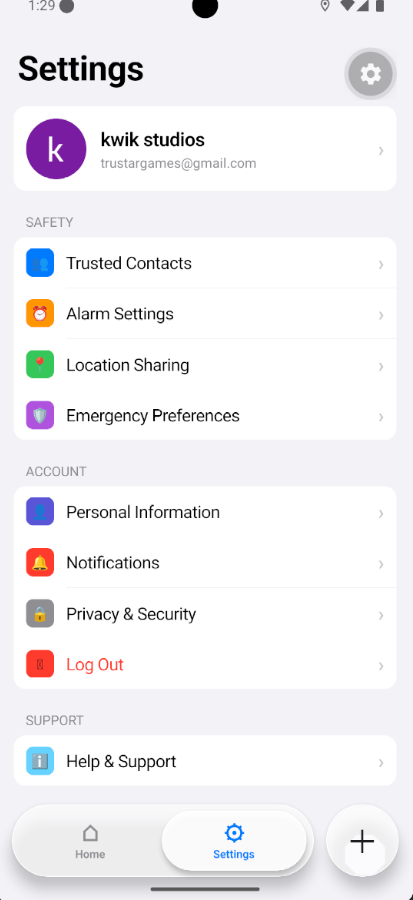

<div align="center">

# 🛡️ FellowSafe

### *Empowering safety, security, and connectivity for communities.*

[](https://opensource.org/licenses/MIT)
[](https://reactnative.dev/)
[](https://expo.dev/)
[](https://tailwindcss.com/)

</div>

---

## 📖 About **FellowSafe**

**FellowSafe** is a modern, safety-focused application designed to provide reliable tracking, emergency alerts, and peace of mind for users and their trusted circles. Built with cross-platform scalability in mind, it aims to make community and personal safety accessible, fast, and efficient right from your smartphone.

---

## 📸 Screenshots

<div align="center">
  
  

  

  <br/><br/>
  
  

  
  
</div>

---

## ✨ Key Features

- **🚨 Instant SOS Trigger:** Rapidly dispatches emergency notifications accompanied by precise geolocation coordinates.
- **🔔 Real-Time Lockscreen Alert Alarm:** Overrides lockscreen restrictions using custom native Android modules to trigger immediate, high-priority audible alarms during critical emergencies.
- **📡 Native Real-Time Location Sharing:** Leverages background location services via native Android integration for accurate, low-latency live location updates to contacts.
- **👥 Trusted Circle Management:** Seamlessly add, manage, and coordinate with emergency contacts and family members.
- **🎨 Modern, Clean UI:** Designed for swift and intuitive interaction during high-stress scenarios.

---

## 🛠️ Tech Stack

- **Frontend / Mobile:** [React Native](https://reactnative.dev/) with [Expo](https://expo.dev/)
- **Styling:** [Tailwind CSS](https://tailwindcss.com/) (via NativeWind or similar configuration)
- **State & Navigation:** React Navigation / Context API / State Management

---

## 🚀 Getting Started

Follow these steps to set up the project locally on your machine.

### Prerequisites

Ensure you have the following installed:
- [Node.js](https://nodejs.org/) (LTS recommended)
- [npm](https://www.npmjs.com/) or [Yarn](https://yarnpkg.com/)
- [Expo Go app](https://expo.dev/client) on your physical mobile device (or an iOS/Android emulator setup)

### Installation & Setup

1. **Clone the repository:**
   ```bash
   git clone [https://github.com/iamkanishhk/FellowSafe.git](https://github.com/iamkanishhk/FellowSafe.git)
